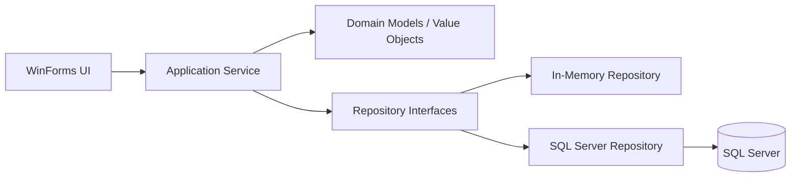

# RentFlowMini Project Roadmap

เอกสารนี้เป็น roadmap ระดับโครงการสำหรับกำหนดลำดับพัฒนาหลังจาก baseline ปัจจุบันของ RentFlowMini ผ่านการตรวจสอบแล้ว โดยแยกงานที่เสร็จแล้ว งานที่ต้องยืนยันก่อนเริ่ม และฟีเจอร์ที่ยังไม่อยู่ในขอบเขตออกจากกัน

**วันที่อัปเดต:** 2026-11-06  
**สถานะ:** ระยะ 0-1 เสร็จแล้ว; ระยะ 2-3 เสร็จในส่วน In-Memory และ UI แต่ยังขาดการเก็บข้อมูลถาวรและการบังคับกฎบางข้อใน service; ระยะ 4 (Cable/Parking) ได้รับการยืนยันและ implement แล้ว

> **การเปลี่ยนแผน (2026-11-06):** เจ้าของโครงการตัดสินใจใช้ SQLite แทน SQL Server รายละเอียดอยู่ใน [แผนเปลี่ยนเป็น SQLite](sqlite-migration-plan.md) ข้อความอื่นในเอกสารนี้ที่พูดถึง SQL Server จะปรับเมื่อระบบย้ายเสร็จ

## 1. เป้าหมายและหลักการ

- พัฒนาทีละระยะโดยเริ่มจาก Domain contract และ tests ก่อน persistence และ UI
- ไม่เพิ่มฟีเจอร์ใหม่บนสัญญาที่ขัดแย้งกันหรือยังไม่มีข้อกำหนดที่ยืนยันแล้ว
- รักษากติกาเดิมของ UC-01 ได้แก่ billing period รูปแบบ `YYYY-MM`, การตรวจ meter และการป้องกันบิลซ้ำ
- ใช้เอกสารนี้กำหนดลำดับระดับโครงการ ส่วนรายละเอียด UC-01 ให้ดูที่ [implementation plan](implementation-plan.md) และ [ข้อกำหนด UC-01](uc-01-create-monthly-bill.md)

## 2. สถานะปัจจุบัน (Baseline)

จาก [current-code-status](current-code-status.md) ระบบปัจจุบันมีความสามารถดังนี้:

- จัดการห้องพัก (ค่าเช่า, สถานะยกเว้น Cable TV, แก้ไขค่าเช่า) ผ่าน In-Memory และ SQL Server Repository
- จัดการผู้เช่าและผูกกับห้อง ผ่าน In-Memory และ SQL Server Repository
- ตั้งค่าราคากลางและข้อมูลหอพัก บันทึกในฐานข้อมูล SQLite นอก repo
- บันทึกมิเตอร์รายเดือน (`MonthlyMeterReading`) แบบ upsert
- สร้างบิล 6 รายการ (ค่าเช่า, น้ำ, ไฟ, จอดมอเตอร์ไซค์, จอดรถยนต์, Cable TV) พร้อมเลขใบแจ้งหนี้
- WinForms แยกแท็บ: ห้องพัก, บันทึกมิเตอร์, สร้างบิล, ผู้เช่า, รายงาน, ตั้งค่าพื้นฐาน
- แอปที่รันจริงเก็บข้อมูลทุกส่วนใน SQLite ปิดแล้วเปิดใหม่ข้อมูลอยู่ครบ
- automated tests ผ่าน 444 รายการ และมี CI workflow

### สิ่งที่ยังไม่อยู่ใน baseline

- ระบบสำรองและกู้คืนข้อมูล ซึ่งต้องเสร็จก่อนใส่ข้อมูลจริง
- การบังคับในระดับ service ว่าต้องมีผู้เช่าและมิเตอร์ก่อนสร้างบิล
- ค่าตั้งต้นการจอดรถรายห้อง
- การแก้ไขค่าเช่า ค่าน้ำ และค่าไฟของบิลเดิม (ปัจจุบันแก้ได้เฉพาะช่องติ๊กค่าจอดรถและยกเว้น Cable TV)
- การเปลี่ยนผู้เช่ากลางเดือน, ประวัติค่าเช่า และ pricing แยกตามอาคารหรือห้อง

## 3. สถาปัตยกรรมและลำดับการทำงาน

แต่ละระยะต้องเดินตามลำดับชั้นนี้ และไม่เริ่มจากการเพิ่ม field บน UI เพียงอย่างเดียว:

หลักการทดสอบคือเขียน requirement สั้น ๆ, เพิ่ม test ที่แสดงพฤติกรรม, ทำ implementation เท่าที่จำเป็น, refactor และรัน test ก่อนเชื่อมต่อชั้นถัดไป

## 4. Roadmap ตามระยะ

### ระยะ 0: ยืนยัน baseline — เสร็จแล้ว

**เป้าหมาย:** ทำให้ UC-01 MVP และโครงสร้างห้องพักเป็นจุดเริ่มต้นที่ตรวจสอบได้

**ผลลัพธ์ที่มีแล้ว:**

- Domain, Application, Infrastructure, UI และ tests ของ UC-01 เชื่อมกันครบ
- SQL scripts `001_CreateRooms.sql` และ `002_CreateBills.sql` ถูกใช้โดย CI
- `dotnet test` ผ่าน 54 รายการ และ Release build ผ่าน (ณ เวลาที่ปิดระยะ 0)

**เกณฑ์เสร็จ:** อ้างอิงสถานะล่าสุดจาก `current-code-status.md` และไม่ถือ Cable/Parking หรือ Tenant เป็น implementation ที่มีอยู่แล้ว

### ระยะ 1: Tenant foundation — เสร็จแล้ว

ดูรายละเอียดแผน implement ได้ที่ [Tenant foundation implementation plan](tenant-implementation-plan.md)

**ความคืบหน้าล่าสุด:** Domain model, Application service, In-Memory repository, `SqlServerTenantRepository` พร้อม `003_CreateTenants.sql`, WinForms UI และ tests ของ Tenant ผ่านแล้ว ([tenant-sql-persistence-plan.md](tenant-sql-persistence-plan.md)); แก้ไขและย้ายออกได้แล้ว แต่ยังไม่มีการลบผู้เช่า

**เงื่อนไขเริ่มต้น:** ระยะ 0 ยังผ่าน และยังไม่เพิ่มกติกา Cable/Parking เข้ามาปะปน

**งานหลัก:**

- ยืนยัน requirement ขั้นต่ำของผู้เช่า เช่น ตัวตน ชื่อ และข้อมูลติดต่อ
- ออกแบบ `Tenant` และ value objects ที่จำเป็น โดยกำหนด validation ให้ชัด
- กำหนด `ITenantRepository` และเริ่มจาก In-Memory implementation
- เพิ่ม Application service และ tests ตาม pattern ของ `Room` / `IRoomRepository`
- กำหนดความสัมพันธ์ผู้เช่ากับห้องโดยไม่ทำลายข้อมูลห้องและบิลเดิม

**ยังไม่ทำในระยะนี้:** UI และ SQL Server จนกว่า Domain contract, Application behavior และ In-Memory tests จะผ่าน

**Definition of Done:** สร้าง/อ่านผู้เช่าตามกติกาที่อนุมัติได้, validation และกรณีข้อมูลซ้ำมี tests, tests ที่เกี่ยวข้องผ่าน และเอกสาร requirement ถูกอัปเดต

### ระยะ 2: Meter persistence — In-Memory เสร็จแล้ว, SQL Server ยังไม่เริ่ม

**ความคืบหน้าล่าสุด:** มี `MonthlyMeterReading`, `IMonthlyMeterReadingRepository`, `InMemoryMonthlyMeterReadingRepository`, `SaveMonthlyMeterReadingService` (upsert) และแท็บบันทึกมิเตอร์ ([billing-meter-reading-plan.md](billing-meter-reading-plan.md), [billing-meter-reading-ui-plan.md](billing-meter-reading-ui-plan.md)); ยังไม่มี schema และ SQL Server repository

**เงื่อนไขเริ่มต้น:** มี contract ของ Tenant ที่ผ่านแล้ว และยังรักษา `MeterReading` validation เดิม

**งานหลัก:**

- กำหนด model ของการอ่านมิเตอร์ที่ระบุห้อง ประเภทมิเตอร์ รอบเวลา และค่า reading
- กำหนดกติกาเรื่อง reading ซ้ำ ลำดับเวลา และข้อมูลที่แก้ไขไม่ได้หรือแก้ไขได้
- สร้าง `IMeterRepository` และ In-Memory implementation
- เพิ่ม tests สำหรับการบันทึก ค้นหา reading และกรณีข้อมูลไม่ถูกต้อง
- ออกแบบแนวทาง SQL Server หลัง contract ในหน่วยความจำมีความชัดเจนแล้ว

**Definition of Done:** ค้นหา meter reading ของห้องและรอบที่ต้องการได้, ตรวจกรณีผิดปกติได้, In-Memory tests ผ่าน และมีแผน schema/migration ที่ไม่เปิดเผย secret

### ระยะ 3: Billing integration — ทำแล้วบางส่วน

**ความคืบหน้าล่าสุด:** UI สร้างบิลอ่านห้อง ผู้เช่า และมิเตอร์จาก repository แล้ว และบิลมีเลขใบแจ้งหนี้; แต่ `CreateMonthlyBillService` ยังรับค่าทั้งหมดผ่าน request และยังไม่ตรวจว่ามีผู้เช่า/มิเตอร์ของรอบนั้น ส่วน `SqlServerBillRepository` ยังไม่รองรับยอด 6 รายการ, เลขใบแจ้งหนี้ และการอ่านบิล

**เงื่อนไขเริ่มต้น:** Tenant และ Meter repository ผ่านตาม Definition of Done ของตนเอง

**งานหลัก:**

- ให้ `CreateMonthlyBillService` อ่านข้อมูลห้อง ผู้เช่า และ meter จาก repository ตาม contract ที่ตกลง
- คงการตรวจ meter, รูปแบบ `YYYY-MM` และการป้องกันบิลซ้ำ
- ปรับ In-Memory tests ก่อนเชื่อม SQL Server และ UI
- เพิ่ม integration tests เฉพาะเมื่อ schema และ migration พร้อม
- อัปเดต `current-code-status.md` และเอกสาร UC-01 ให้ตรงกับ behavior จริง

**Definition of Done:** สร้างบิลจากข้อมูล repository ได้ครบ, กรณีข้อมูลหาย/meter ผิด/บิลซ้ำยังหยุดได้ถูกต้อง, tests ทุกชั้นที่ได้รับผลกระทบผ่าน และไม่มี regression ของ UC-01

### ระยะ 4: ตัดสินใจ Cable/Parking — ยืนยันและ implement แล้ว

**ความคืบหน้าล่าสุด:** กติกาถูกยืนยันใน [billing-charges-design.md](billing-charges-design.md) และ implement ใน `BillingSettings`, `BillingCalculator`, `Bill`, `CreateMonthlyBillService` และแท็บสร้างบิลแล้ว (เลือกจอดรถรายรอบบิล, ยกเว้น Cable TV ตามห้อง); ยังเหลือค่าตั้งต้นการจอดรถรายห้อง และ schema/migration ของ SQL Server

เงื่อนไขเดิมของระยะนี้ (เก็บไว้อ้างอิง):

ก่อนเริ่มต้องยืนยันอย่างน้อย:

- Cable เป็นบริการบังคับหรือเลือกได้ และอัตราค่าบริการ/ช่วงเวลาคิดเงิน
- Parking คิดตามประเภทยานพาหนะ จำนวนคัน สิทธิ์ฟรี และอัตราที่แน่นอน
- ผลกระทบต่อ Bill, calculator, repository, database migration และ UI
- การแก้ไขย้อนหลังและการ Recalculate เมื่อกติกาเปลี่ยน

เมื่อได้รับการอนุมัติแล้วจึงค่อยเขียน requirement และ tests ก่อนแก้ `BillingCalculator`, `Bill`, `SqlServerBillRepository`, schema และ `RoomForm`

### ระยะ 5: ใบแจ้งหนี้และการชำระเงิน — กำลังทำ

**หลักการ:** เริ่มแบบง่าย 1 บิล = 1 ใบแจ้งหนี้ และเก็บสถานะแค่ "ยังไม่จ่าย" กับ "จ่ายแล้ว" ส่วน "เกินกำหนด" คำนวณจากวันครบกำหนด

**กติกาที่เจ้าของโครงการยืนยันแล้ว:**

- วันครบกำหนดคือวันที่ 5 ของเดือนถัดจากรอบบิล
- ใบแจ้งหนี้ต้องมีชื่อหอพักและที่อยู่
- ช่องทางชำระเงินคือเงินสดและโอนเข้าบัญชี
- พิมพ์ 3 ใบต่อกระดาษ A4 หนึ่งแผ่น โดยจัดหน้าตามแบบบิลที่ใช้อยู่ และแยกค่าจอดมอเตอร์ไซค์ ค่าจอดรถยนต์ และ Cable TV คนละบรรทัด
- พิมพ์ได้ทั้งรอบบิลและเฉพาะห้องที่เลือก

**ลำดับงาน:**

1. เก็บมิเตอร์และอัตราน้ำ-ไฟไว้ในบิล และเพิ่มวันครบกำหนด — เสร็จแล้ว
2. พิมพ์ใบแจ้งหนี้ด้วย `PrintDocument` และ `PrintPreviewDialog` โดยไม่เพิ่ม package — เสร็จแล้ว
3. บันทึกและยกเลิกการรับชำระ (วันที่รับเงินและช่องทาง รับเฉพาะเต็มจำนวน) และล็อกการแก้ไขบิลที่จ่ายแล้ว — เสร็จแล้ว (ใน In-Memory; `SqlServerBillRepository` ยังไม่เก็บการรับชำระ รอลำดับ 7)
4. สถานะเกินกำหนดและตัวกรองค้างชำระแบบข้ามเดือน — เสร็จแล้ว
5. ปรับแท็บผู้เช่า: ตารางซ่อนรหัส แก้ไข ย้ายออก ค้นหา ยอดค้างชำระ วันเข้าอยู่ เงินประกัน และเก็บผู้เช่าไว้ในบิล — เสร็จแล้ว
6. แท็บรายงานอย่างง่าย: สรุปรอบบิล ยอดแยกประเภทและช่องทาง รายการค้างชำระทุกเดือน สรุปรายปี และส่งออก Excel/PDF ทั้งรายเดือนและรายปี — เสร็จแล้ว
7. เก็บข้อมูลทั้งหมดรวมถึงการตั้งค่าใน SQLite ก่อนใช้งานจริง ตาม [แผนเปลี่ยนเป็น SQLite](sqlite-migration-plan.md) — แอปใช้ SQLite แล้ว เหลือลบโค้ด SQL Server และทำระบบสำรองข้อมูล

**ยังไม่ทำ:** ค่าปรับ, การจ่ายบางส่วน, การรวมยอดค้างเข้าบิลเดือนถัดไป, ใบเสร็จแยก และการส่ง SMS หรือ LINE

## 5. เอกสารและไฟล์อ้างอิง

- สถานะโค้ด: [current-code-status.md](current-code-status.md)
- แผนรายละเอียด UC-01: [implementation-plan.md](implementation-plan.md)
- ข้อกำหนด UC-01: [uc-01-create-monthly-bill.md](uc-01-create-monthly-bill.md)
- Pattern ห้องพัก: `RentFlowApp/Room.cs`, `Application/Rooms/IRoomRepository.cs`, `Application/Rooms/CreateRoomService.cs`
- Pattern billing: `Domain/Billing/BillingCalculator.cs`, `Domain/Billing/Bill.cs`, `Application/Billing/CreateMonthlyBillService.cs`
- Tests: `RentFlowApp.Tests/Domain`, `RentFlowApp.Tests/Application`, `RentFlowApp.Tests/Infrastructure` และ `RentFlowApp.Tests/UI`

## 6. เกณฑ์ร่วมก่อนเลื่อนไประยะถัดไป

- มี requirement หรือ decision ที่ตรวจสอบได้สำหรับ behavior ที่กำลังทำ
- มี tests ครอบคลุมกรณีปกติและกรณีผิดพลาดของชั้นที่เปลี่ยน
- `dotnet build` และ `dotnet test` ผ่านตามขอบเขตที่เกี่ยวข้อง
- SQL migration และ integration test ถูกตรวจเมื่อมีการแตะ persistence
- ไม่มี connection string, password หรือ secret ใน source code, เอกสาร หรือ log
- อัปเดตเอกสารสถานะหลังระยะเสร็จ และไม่เริ่มระยะถัดไปจนกว่า dependency จะผ่าน
