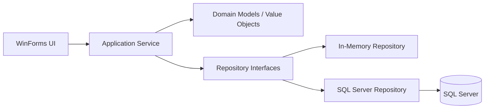

# RentFlowMini Project Roadmap

เอกสารนี้เป็น roadmap ระดับโครงการสำหรับกำหนดลำดับพัฒนาหลังจาก baseline ปัจจุบันของ RentFlowMini ผ่านการตรวจสอบแล้ว โดยแยกงานที่เสร็จแล้ว งานที่ต้องยืนยันก่อนเริ่ม และฟีเจอร์ที่ยังไม่อยู่ในขอบเขตออกจากกัน

**วันที่อัปเดต:** 2026-10-16  
**สถานะ:** Baseline ของ UC-01 MVP ผ่านแล้ว; Tenant foundation กำลัง implement

## 1. เป้าหมายและหลักการ

- พัฒนาทีละระยะโดยเริ่มจาก Domain contract และ tests ก่อน persistence และ UI
- ไม่เพิ่มฟีเจอร์ใหม่บนสัญญาที่ขัดแย้งกันหรือยังไม่มีข้อกำหนดที่ยืนยันแล้ว
- รักษากติกาเดิมของ UC-01 ได้แก่ billing period รูปแบบ `YYYY-MM`, การตรวจ meter และการป้องกันบิลซ้ำ
- ใช้เอกสารนี้กำหนดลำดับระดับโครงการ ส่วนรายละเอียด UC-01 ให้ดูที่ [implementation plan](implementation-plan.md) และ [ข้อกำหนด UC-01](uc-01-create-monthly-bill.md)

## 2. สถานะปัจจุบัน (Baseline)

จาก [current-code-status](current-code-status.md) ระบบปัจจุบันมีความสามารถดังนี้:

- จัดการห้องพักผ่าน `CreateRoomService`, `IRoomRepository`, In-Memory Repository และ SQL Server Repository
- สร้างบิลรายเดือนผ่าน `CreateMonthlyBillService` และ `BillingCalculator`
- คำนวณค่าเช่า ค่าน้ำ ค่าไฟ และยอดรวมจาก `MeterReading`
- ตรวจสอบ billing period, meter ที่ไม่ครบ, meter ปัจจุบันที่ต่ำกว่าค่าก่อนหน้า และบิลซ้ำ
- บันทึกบิลใน `InMemoryBillRepository` และ `SqlServerBillRepository`
- มี WinForms flow สำหรับจัดการห้องพักและสร้างบิล
- มี automated tests ผ่าน 54 รายการ และมี Release build กับ CI workflow

### สิ่งที่ยังไม่อยู่ใน baseline

- ข้อมูลผู้เช่าและความสัมพันธ์ระหว่างผู้เช่ากับห้อง
- ประวัติและ repository สำหรับ meter reading
- การแก้ไขหรือ Recalculate บิลเดิม
- Cable และ Parking
- การเปลี่ยนผู้เช่ากลางเดือน, ประวัติค่าเช่า และ pricing แยกตามอาคารหรือห้อง

## 3. สถาปัตยกรรมและลำดับการทำงาน

แต่ละระยะต้องเดินตามลำดับชั้นนี้ และไม่เริ่มจากการเพิ่ม field บน UI เพียงอย่างเดียว:

หลักการทดสอบคือเขียน requirement สั้น ๆ, เพิ่ม test ที่แสดงพฤติกรรม, ทำ implementation เท่าที่จำเป็น, refactor และรัน test ก่อนเชื่อมต่อชั้นถัดไป

## 4. Roadmap ตามระยะ

### ระยะ 0: ยืนยัน baseline — เสร็จแล้ว

**เป้าหมาย:** ทำให้ UC-01 MVP และโครงสร้างห้องพักเป็นจุดเริ่มต้นที่ตรวจสอบได้

**ผลลัพธ์ที่มีแล้ว:**

- Domain, Application, Infrastructure, UI และ tests ของ UC-01 เชื่อมกันครบ
- SQL scripts `001_CreateRooms.sql` และ `002_CreateBills.sql` ถูกใช้โดย CI
- `dotnet test` ผ่าน 54 รายการ และ Release build ผ่าน

**เกณฑ์เสร็จ:** อ้างอิงสถานะล่าสุดจาก `current-code-status.md` และไม่ถือ Cable/Parking หรือ Tenant เป็น implementation ที่มีอยู่แล้ว

### ระยะ 1: Tenant foundation — กำลังทำ

ดูรายละเอียดแผน implement ได้ที่ [Tenant foundation implementation plan](tenant-implementation-plan.md)

**ความคืบหน้าล่าสุด:** Domain model, Application service, In-Memory repository และ tests ของ Tenant ผ่านแล้ว; ยังไม่เริ่ม UI, SQL Server และ Billing integration

**เงื่อนไขเริ่มต้น:** ระยะ 0 ยังผ่าน และยังไม่เพิ่มกติกา Cable/Parking เข้ามาปะปน

**งานหลัก:**

- ยืนยัน requirement ขั้นต่ำของผู้เช่า เช่น ตัวตน ชื่อ และข้อมูลติดต่อ
- ออกแบบ `Tenant` และ value objects ที่จำเป็น โดยกำหนด validation ให้ชัด
- กำหนด `ITenantRepository` และเริ่มจาก In-Memory implementation
- เพิ่ม Application service และ tests ตาม pattern ของ `Room` / `IRoomRepository`
- กำหนดความสัมพันธ์ผู้เช่ากับห้องโดยไม่ทำลายข้อมูลห้องและบิลเดิม

**ยังไม่ทำในระยะนี้:** UI และ SQL Server จนกว่า Domain contract, Application behavior และ In-Memory tests จะผ่าน

**Definition of Done:** สร้าง/อ่านผู้เช่าตามกติกาที่อนุมัติได้, validation และกรณีข้อมูลซ้ำมี tests, tests ที่เกี่ยวข้องผ่าน และเอกสาร requirement ถูกอัปเดต

### ระยะ 2: Meter persistence — หลัง Tenant foundation

**เงื่อนไขเริ่มต้น:** มี contract ของ Tenant ที่ผ่านแล้ว และยังรักษา `MeterReading` validation เดิม

**งานหลัก:**

- กำหนด model ของการอ่านมิเตอร์ที่ระบุห้อง ประเภทมิเตอร์ รอบเวลา และค่า reading
- กำหนดกติกาเรื่อง reading ซ้ำ ลำดับเวลา และข้อมูลที่แก้ไขไม่ได้หรือแก้ไขได้
- สร้าง `IMeterRepository` และ In-Memory implementation
- เพิ่ม tests สำหรับการบันทึก ค้นหา reading และกรณีข้อมูลไม่ถูกต้อง
- ออกแบบแนวทาง SQL Server หลัง contract ในหน่วยความจำมีความชัดเจนแล้ว

**Definition of Done:** ค้นหา meter reading ของห้องและรอบที่ต้องการได้, ตรวจกรณีผิดปกติได้, In-Memory tests ผ่าน และมีแผน schema/migration ที่ไม่เปิดเผย secret

### ระยะ 3: Billing integration — หลัง Tenant และ Meter

**เงื่อนไขเริ่มต้น:** Tenant และ Meter repository ผ่านตาม Definition of Done ของตนเอง

**งานหลัก:**

- ให้ `CreateMonthlyBillService` อ่านข้อมูลห้อง ผู้เช่า และ meter จาก repository ตาม contract ที่ตกลง
- คงการตรวจ meter, รูปแบบ `YYYY-MM` และการป้องกันบิลซ้ำ
- ปรับ In-Memory tests ก่อนเชื่อม SQL Server และ UI
- เพิ่ม integration tests เฉพาะเมื่อ schema และ migration พร้อม
- อัปเดต `current-code-status.md` และเอกสาร UC-01 ให้ตรงกับ behavior จริง

**Definition of Done:** สร้างบิลจากข้อมูล repository ได้ครบ, กรณีข้อมูลหาย/meter ผิด/บิลซ้ำยังหยุดได้ถูกต้อง, tests ทุกชั้นที่ได้รับผลกระทบผ่าน และไม่มี regression ของ UC-01

### ระยะ 4: ตัดสินใจ Cable/Parking — ยังไม่อนุมัติ

ระยะนี้เป็นจุดตัดสินใจ ไม่ใช่ requirement ที่เริ่ม implement ได้ทันที

ก่อนเริ่มต้องยืนยันอย่างน้อย:

- Cable เป็นบริการบังคับหรือเลือกได้ และอัตราค่าบริการ/ช่วงเวลาคิดเงิน
- Parking คิดตามประเภทยานพาหนะ จำนวนคัน สิทธิ์ฟรี และอัตราที่แน่นอน
- ผลกระทบต่อ Bill, calculator, repository, database migration และ UI
- การแก้ไขย้อนหลังและการ Recalculate เมื่อกติกาเปลี่ยน

เมื่อได้รับการอนุมัติแล้วจึงค่อยเขียน requirement และ tests ก่อนแก้ `BillingCalculator`, `Bill`, `SqlServerBillRepository`, schema และ `RoomForm`

## 5. เอกสารและไฟล์อ้างอิง

- สถานะโค้ด: [current-code-status.md](current-code-status.md)
- แผนรายละเอียด UC-01: [implementation-plan.md](implementation-plan.md)
- ข้อกำหนด UC-01: [uc-01-create-monthly-bill.md](uc-01-create-monthly-bill.md)
- Pattern ห้องพัก: `RentFlowApp/Room.cs`, `Application/Rooms/IRoomRepository.cs`, `Application/Rooms/CreateRoomService.cs`
- Pattern billing: `Domain/Billing/BillingCalculator.cs`, `Domain/Billing/Bill.cs`, `Application/Billing/CreateMonthlyBillService.cs`
- Tests: `RentFlowApp.Tests/Domain`, `RentFlowApp.Tests/Application`, `RentFlowApp.Tests/Infrastructure` และ `RentFlowApp.Tests/UI`

## 6. เกณฑ์ร่วมก่อนเลื่อนไประยะถัดไป

- มี requirement หรือ decision ที่ตรวจสอบได้สำหรับ behavior ที่กำลังทำ
- มี tests ครอบคลุมกรณีปกติและกรณีผิดพลาดของชั้นที่เปลี่ยน
- `dotnet build` และ `dotnet test` ผ่านตามขอบเขตที่เกี่ยวข้อง
- SQL migration และ integration test ถูกตรวจเมื่อมีการแตะ persistence
- ไม่มี connection string, password หรือ secret ใน source code, เอกสาร หรือ log
- อัปเดตเอกสารสถานะหลังระยะเสร็จ และไม่เริ่มระยะถัดไปจนกว่า dependency จะผ่าน
