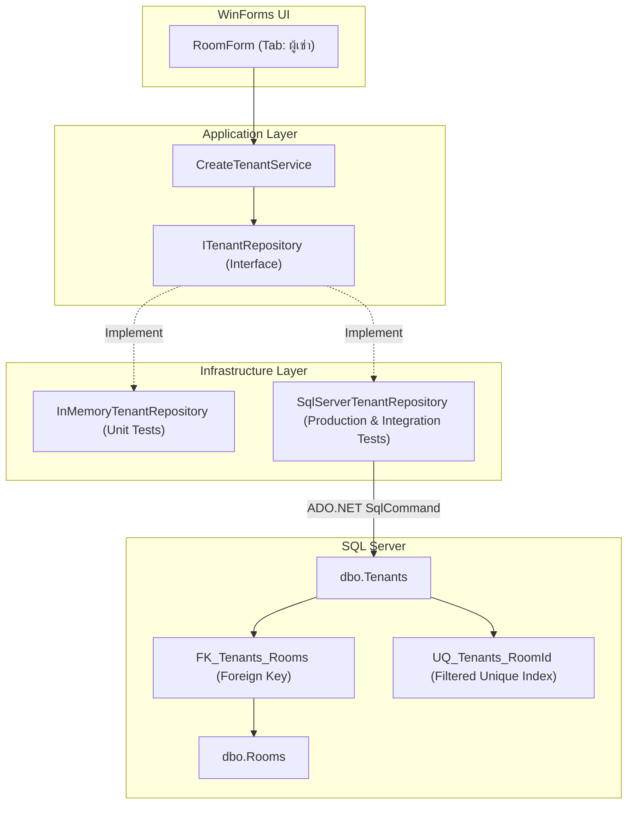

# แผนการ Implement SQL Server Persistence สำหรับข้อมูลผู้เช่า (Tenant)

เอกสารนี้เป็นแผนการพัฒนาการจัดเก็บข้อมูลผู้เช่า (Tenant) ลงสู่ฐานข้อมูล SQL Server จริง เพื่อให้ข้อมูลคงอยู่ถาวร (Persistent) แทนการใช้หน่วยความจำชั่วคราว (In-Memory) โดยเดินตามแนวทาง Micro Development และสถาปัตยกรรม Clean Architecture ของ RentFlowMini

- **เอกสารอ้างอิง:** [roadmap.md](file:///e:/IT/Developer/Programmer/RentFlow_With_C_Sharp/RentFlowMini/docs/roadmap.md), [tenant-implementation-plan.md](file:///e:/IT/Developer/Programmer/RentFlow_With_C_Sharp/RentFlowMini/docs/tenant-implementation-plan.md), [tenant-ui-implementation-plan.md](file:///e:/IT/Developer/Programmer/RentFlow_With_C_Sharp/RentFlowMini/docs/tenant-ui-implementation-plan.md)
- **สถานะเริ่มต้น:** Domain, Application, UI (WinForms) และ In-Memory Repository ทำงานครบถ้วนและผ่านการทดสอบ 80 เทสต์เรียบร้อยแล้ว

### สถานะการดำเนินงานล่าสุด

- Implementation ของ SQL schema, repository, Program.cs และ Integration Test ครบตามขอบเขตแล้ว
- การยืนยัน Integration Test ต้องใช้ SQL Server connection ที่กำหนดผ่าน `RENTFLOW_TEST_CONNECTION` หรือ local SQL Server ที่รองรับ Windows Authentication
- หาก environment เชื่อมต่อ SQL Server ไม่ได้ ผลทดสอบจะยังไม่ถือว่าเป็นข้อผิดพลาดของ repository หรือ schema โดยอัตโนมัติ

---

## 1. เป้าหมายและขอบเขตงาน (Scope & Objectives)

### 1.1 เป้าหมายหลัก
1. สร้างฐานข้อมูล Schema สำหรับจัดเก็บข้อมูลผู้เช่าใน SQL Server ผ่านไฟล์ migration script `003_CreateTenants.sql`
2. สร้าง `SqlServerTenantRepository` ที่ implement อินเทอร์เฟซ [ITenantRepository](file:///e:/IT/Developer/Programmer/RentFlow_With_C_Sharp/RentFlowMini/RentFlowMini/RentFlowApp/Application/Tenants/ITenantRepository.cs)
3. ป้องกันปัญหาความซ้ำซ้อนของข้อมูล (Data Integrity) ในระดับฐานข้อมูล โดยกำหนดให้ **1 ห้องพักมีผู้เช่าปัจจุบันได้ไม่เกิน 1 คน** แต่ผู้เช่าสามารถไม่มีห้องพักได้หลายคน
4. เขียน Integration Tests ทดสอบการทำงานกับ SQL Server จริงให้ครอบคลุมทุกกรณี
5. ปรับปรุง [Program.cs](file:///e:/IT/Developer/Programmer/RentFlow_With_C_Sharp/RentFlowMini/RentFlowMini/RentFlowApp/Program.cs) ให้เชื่อมต่อ `SqlServerTenantRepository` เพื่อใช้งานใน Production
6. อัปเดต GitHub Actions Workflow (`.github/workflows/dotnet.yml`) ให้รันสคริปต์ตารางผู้เช่าในกระบวนการ CI อัตโนมัติ

### 1.2 สิ่งที่ยังไม่อยู่ในขอบเขตงานนี้ (Out of Scope)
- การสร้างตารางประวัติการย้ายห้อง/สัญญาเช่า (Rental Contract History)
- การพิมพ์ใบแจ้งหนี้ที่มีชื่อผู้เช่า (จะอยู่ในระยะ Billing Integration ถัดไป)

---

## 2. การออกแบบ Database Schema (`dbo.Tenants`)

### 2.1 โครงสร้างตารางและ Constraints

ไฟล์สคริปต์: `RentFlowMini/RentFlowApp/Database/003_CreateTenants.sql`

```sql
CREATE TABLE dbo.Tenants
(
    Id UNIQUEIDENTIFIER NOT NULL,
    FirstName NVARCHAR(100) NOT NULL,
    LastName NVARCHAR(100) NOT NULL,
    PhoneNumber NVARCHAR(20) NULL,
    RoomId UNIQUEIDENTIFIER NULL,

    CONSTRAINT PK_Tenants
        PRIMARY KEY (Id),

    CONSTRAINT FK_Tenants_Rooms
        FOREIGN KEY (RoomId) REFERENCES dbo.Rooms (Id)
);

-- บังคับกติกาธุรกิจ: 1 ห้องพักมีผู้เช่าปัจจุบันได้ไม่เกิน 1 คน (เฉพาะกรณีมีห้องพัก)
-- ผู้เช่าที่ยังไม่มีห้องพัก (RoomId IS NULL) สามารถมีได้หลายคนโดยไม่ติด Unique constraint
CREATE UNIQUE NONCLUSTERED INDEX UQ_Tenants_RoomId
    ON dbo.Tenants (RoomId)
    WHERE RoomId IS NOT NULL;
```

### 2.2 เหตุผลการออกแบบ (Design Rationale)
- **`Id`:** ใช้ `UNIQUEIDENTIFIER` สอดคล้องกับ `TenantId` และ Pattern ของ `Rooms`/`Bills`
- **`FirstName` / `LastName`:** กำหนดเป็น `NVARCHAR(100) NOT NULL` รองรับชื่อภาษาไทยและภาษาอื่น ๆ
- **`PhoneNumber`:** เป็น `NVARCHAR(20) NULL` รองรับเบอร์โทร 9-10 หลัก หรือเว้นว่างได้
- **`RoomId`:** เป็น `UNIQUEIDENTIFIER NULL` มี Foreign Key ผูกกับ `dbo.Rooms(Id)`
- **`UQ_Tenants_RoomId` (Filtered Index):** สำคัญมากสำหรับการการันตีกฎธุรกิจ "ห้องหนึ่งมีผู้เช่าได้ไม่เกินหนึ่งคน" โดยไม่ขัดขวางการสร้างผู้เช่าที่ไม่มีห้อง

---

## 3. สถาปัตยกรรมและการเชื่อมต่อ (Architecture Flow)



---

## 4. รายละเอียดการพัฒนา `SqlServerTenantRepository`

### 4.1 เมธอดที่ต้อง Implement ตาม `ITenantRepository`

| เมธอด | คำสั่ง SQL และการทำงาน | การดักจับ Exception |
|---|---|---|
| `Add(Tenant tenant)` | `INSERT INTO dbo.Tenants (Id, FirstName, LastName, PhoneNumber, RoomId) VALUES (@Id, @FirstName, @LastName, @PhoneNumber, @RoomId)` | ดัก `SqlException.Number is 2601 or 2627` โยน `InvalidOperationException("ห้องพักนี้มีผู้เช่าอยู่แล้ว ไม่สามารถผูกผู้เช่าซ้ำได้")` |
| `GetById(TenantId tenantId)` | `SELECT Id, FirstName, LastName, PhoneNumber, RoomId FROM dbo.Tenants WHERE Id = @Id` | คืนค่า `Tenant?` (หากไม่พบ คืนค่า `null`) |
| `ExistsByRoomId(RoomId roomId)` | `SELECT CASE WHEN EXISTS (SELECT 1 FROM dbo.Tenants WHERE RoomId = @RoomId) THEN 1 ELSE 0 END` | คืนค่า `bool` |
| `GetAll()` | `SELECT Id, FirstName, LastName, PhoneNumber, RoomId FROM dbo.Tenants ORDER BY FirstName, LastName` | คืนค่า `IReadOnlyList<Tenant>` |

### 4.2 การจัดการค่า Nullable ใน ADO.NET
- สำหรับ `PhoneNumber`: `command.Parameters.Add("@PhoneNumber", SqlDbType.NVarChar, 20).Value = (object?)tenant.PhoneNumber ?? DBNull.Value;`
- สำหรับ `RoomId`: `command.Parameters.Add("@RoomId", SqlDbType.UniqueIdentifier).Value = (object?)tenant.RoomId?.Value ?? DBNull.Value;`
- การอ่านค่ากลับ: ตรวจสอบ `reader.IsDBNull(index)` ก่อนแปลงค่า

---

## 5. ลำดับขั้นตอนการพัฒนา (Implementation Phases)

### Phase 1: สร้าง SQL Script และอัปเดต CI Workflow
- สร้างไฟล์ `RentFlowMini/RentFlowApp/Database/003_CreateTenants.sql`
- เพิ่มขั้นตอนการรันสคริปต์ `003_CreateTenants.sql` ใน `.github/workflows/dotnet.yml` ต่อจาก `002_CreateBills.sql`

### Phase 2: พัฒนา `SqlServerTenantRepository`
- สร้างไฟล์ `RentFlowMini/RentFlowApp/Infrastructure/Tenants/SqlServerTenantRepository.cs`
- พัฒนาโครงสร้างคลาส, Constructor ตรวจสอบ Connection String, และ implement ทั้ง 4 เมธอดตามข้อกำหนด
- ตรวจสอบว่าไม่มี SQL Injection โดยใช้ parameterized queries ทั้งหมด

### Phase 3: เขียน Integration Tests สำหรับ SQL Server
- สร้างไฟล์ `RentFlowApp.Tests/Infrastructure/Tenants/SqlServerTenantRepositoryTests.cs`
- ใช้ `RENTFLOW_TEST_CONNECTION` สำหรับการเชื่อมต่อ
- กรณีทดสอบที่ต้องมี:
  1. [x] `Add_WithValidTenant_StoresTenantInDatabaseAndCanBeReadById`: ทดสอบการบันทึกและอ่านกลับผู้เช่าที่มีห้อง
  2. [x] `Add_WithDuplicateId_ThrowsInvalidOperationException`: ทดสอบการปฏิเสธ TenantId ซ้ำ
  3. [x] `Add_WithOccupiedRoom_ThrowsInvalidOperationException`: ทดสอบการปฏิเสธการผูกห้องซ้ำผ่าน Filtered Unique Index
  4. [x] `Add_MultipleTenantsWithoutRoom_IsAllowed`: ทดสอบว่าผู้เช่าหลายคนไม่มีห้องพักได้โดยไม่ Error
  5. [x] `ExistsByRoomId_WhenRoomHasTenant_ReturnsTrue`: ทดสอบตรวจพบห้องที่มีผู้เช่า
  6. [x] `ExistsByRoomId_WhenRoomIsEmpty_ReturnsFalse`: ทดสอบห้องว่างคืนค่า false
  7. [x] `GetAll_ReturnsAllSavedTenants`: ทดสอบการดึงรายการผู้เช่าทั้งหมด
- ทุก Test ต้องมี `finally` block สำหรับลบข้อมูลทดสอบ (`DeleteTestTenant`, `DeleteTestRoom`) เพื่อไม่ให้กระทบ Test อื่น

### Phase 4: เชื่อมต่อใน Program.cs สำหรับ Production
- ใน [Program.cs](file:///e:/IT/Developer/Programmer/RentFlow_With_C_Sharp/RentFlowMini/RentFlowMini/RentFlowApp/Program.cs):
  ```csharp
  ITenantRepository tenantRepository =
      new SqlServerTenantRepository(connectionString);
  ```
- ทดสอบเปิดใช้งานแอปพลิเคชันจริง เชื่อมต่อกับ SQL Server

### Phase 5: ทดสอบและตรวจสอบความปลอดภัย (Verification)
- รันทดสอบ unit tests เดิมและเทสต์ใหม่ทั้งหมด
- รัน Release build ยืนยันว่าไม่มี warning หรือ error
- ตรวจสอบว่าไม่มี connection string หรือ secret หลุดเข้าไปใน source code

---

## 6. Definition of Done (เกณฑ์ความสำเร็จ)

- [x] มีไฟล์ `003_CreateTenants.sql` พร้อม Primary Key, Foreign Key และ Filtered Unique Index
- [x] CI Workflow (`.github/workflows/dotnet.yml`) รัน `003_CreateTenants.sql` ครบถ้วน
- [x] `SqlServerTenantRepository` ผ่าน Integration Tests ทุกกรณีใน environment ที่เชื่อมต่อ SQL Server ได้

- [x] ป้องกันการผูกห้องซ้ำในระดับ SQL Server ด้วย Filtered Unique Index
- [x] [Program.cs](file:///e:/IT/Developer/Programmer/RentFlow_With_C_Sharp/RentFlowMini/RentFlowMini/RentFlowApp/Program.cs) สร้าง `SqlServerTenantRepository` แล้ว
- [x] Release build ผ่านโดยไม่มี warning หรือ error (`dotnet build -c Release`)
- [x] ไม่มี secret หรือ credential ปรากฏใน repository
