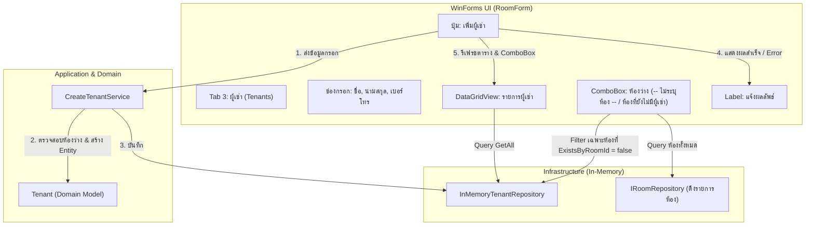

# แผนการ Implement Tenant UI (แท็บจัดการผู้เช่าใน RoomForm เชื่อมต่อ InMemory)

เอกสารนี้เป็นแผนการพัฒนา UI สำหรับจัดการผู้เช่า (Tenant) ในรูปแบบแท็บที่ 3 บน [RoomForm](file:///e:/IT/Developer/Programmer/RentFlow_With_C_Sharp/RentFlowMini/RentFlowMini/RentFlowApp/UI/RoomForm.cs) โดยเชื่อมต่อกับ Backend ผ่าน [InMemoryTenantRepository](file:///e:/IT/Developer/Programmer/RentFlow_With_C_Sharp/RentFlowMini/RentFlowMini/RentFlowApp/Infrastructure/Tenants/InMemoryTenantRepository.cs) และ [CreateTenantService](file:///e:/IT/Developer/Programmer/RentFlow_With_C_Sharp/RentFlowMini/RentFlowMini/RentFlowApp/Application/Tenants/CreateTenantService.cs) ที่มีอยู่แล้ว **เน้นการสร้าง UI ให้ครบถ้วนก่อน โดยยังไม่สร้างตาราง SQL Server หรือ migration ในขั้นตอนนี้**

- **เอกสารอ้างอิง:** [roadmap.md](file:///e:/IT/Developer/Programmer/RentFlow_With_C_Sharp/RentFlowMini/docs/roadmap.md), [tenant-implementation-plan.md](file:///e:/IT/Developer/Programmer/RentFlow_With_C_Sharp/RentFlowMini/docs/tenant-implementation-plan.md)
- **แนวทางหลัก:** Micro Development — เน้นพัฒนา UI ทีละขั้นตอน พร้อมเขียน UI Tests ตรวจสอบพฤติกรรม

---

## 1. เป้าหมายและขอบเขตงาน (Scope & Objectives)

### 1.1 ขอบเขตงานรอบนี้ (In Scope)
1. **เพิ่มแท็บที่ 3 ใน [RoomForm](file:///e:/IT/Developer/Programmer/RentFlow_With_C_Sharp/RentFlowMini/RentFlowMini/RentFlowApp/UI/RoomForm.cs):** แท็บ `"ผู้เช่า (Tenants)"` ต่อจากแท็บ "ห้องพัก" และ "สร้างบิลประจำเดือน"
2. **หน้าจอรับข้อมูลและแสดงผล (UI Controls):**
   - ช่องกรอก: ชื่อผู้เช่า (`FirstName`), นามสกุล (`LastName`), เบอร์โทรศัพท์ (`PhoneNumber` จำกัด MaxLength 10 ตัวอักษร, รับเฉพาะตัวเลขใน UI และตรวจใน Domain ให้เป็นตัวเลข 9-10 หลักหรือเว้นว่าง)
   - Dropdown เลือกห้องพัก (`RoomId`): กรองแสดงเฉพาะ **ห้องว่าง** ที่ยังไม่มีผู้เช่าปัจจุบัน พร้อมตัวเลือกเริ่มต้น `-- ไม่ระบุห้องพัก --`
   - ปุ่ม: "เพิ่มผู้เช่า"
   - Label: แสดงข้อความแจ้งเตือนสถานะสำเร็จ (สีเขียว) หรือข้อผิดพลาด (สีแดง)
   - ตาราง DataGridView: แสดงรายการผู้เช่าทั้งหมด พร้อมชื่อห้องพักที่ผูกอยู่
3. **การเชื่อมต่อ Backend:**
   - ใช้ [CreateTenantService](file:///e:/IT/Developer/Programmer/RentFlow_With_C_Sharp/RentFlowMini/RentFlowMini/RentFlowApp/Application/Tenants/CreateTenantService.cs) และ [ITenantRepository](file:///e:/IT/Developer/Programmer/RentFlow_With_C_Sharp/RentFlowMini/RentFlowMini/RentFlowApp/Application/Tenants/ITenantRepository.cs)
   - ใช้ [InMemoryTenantRepository](file:///e:/IT/Developer/Programmer/RentFlow_With_C_Sharp/RentFlowMini/RentFlowMini/RentFlowApp/Infrastructure/Tenants/InMemoryTenantRepository.cs) สำหรับทั้งการรันแอปพลิเคชันและการทดสอบ
4. **Automated UI Tests:** เขียน Unit Test บน Thread STA ใน [RoomFormTests](file:///e:/IT/Developer/Programmer/RentFlow_With_C_Sharp/RentFlowMini/RentFlowApp.Tests/UI/RoomFormTests.cs) ครอบคลุมการแสดงผลแท็บ, การกรองห้องว่าง และการเพิ่มผู้เช่า

### 1.2 สิ่งที่ยังไม่ทำในรอบนี้ (Deferred / Out of Scope)
- ❌ **SQL Server Persistence:** ยังไม่สร้างไฟล์ `003_CreateTenants.sql` และยังไม่สร้าง `SqlServerTenantRepository` (ใช้ In-Memory ก่อน)
- ❌ **Tenant Modification:** ยังไม่มีการแก้ไขข้อมูล, ย้ายห้อง หรือยกเลิกสัญญาเช่า
- ❌ **Billing Integration:** ยังไม่นำข้อมูลผู้เช่าไปผูกกับการคำนวณหรือพิมพ์บิลในหน้านี้

---

## 2. แผนภาพการทำงานและการไหลของข้อมูล (Data Flow)



---

## 3. รายละเอียด UI Layout ในแท็บ "ผู้เช่า (Tenants)"

### 3.1 รายการ Control Elements

| Control Name | Type | ข้อความ/หน้าที่ | คุณสมบัติ & การจัดวาง |
|---|---|---|---|
| `_tenantTitleLabel` | `Label` | `"จัดการข้อมูลผู้เช่า"` | Font: Segoe UI 16pt Bold, Left: 20, Top: 20 |
| `_tenantFirstNameTextBox` | `TextBox` | รับชื่อผู้เช่า (จำเป็น) | Left: 135, Top: 72, Width: 180 |
| `_tenantLastNameTextBox` | `TextBox` | รับนามสกุลผู้เช่า (จำเป็น) | Left: 430, Top: 72, Width: 180 |
| `_tenantPhoneTextBox` | `TextBox` | รับเบอร์โทรศัพท์ (ไม่บังคับ) | Left: 135, Top: 112, Width: 180 |
| `_tenantRoomComboBox` | `ComboBox` | เลือกห้องพักว่าง | Left: 430, Top: 112, Width: 180, Style: `DropDownList` |
| `_addTenantButton` | `Button` | `"เพิ่มผู้เช่า"` | Left: 630, Top: 110, Width: 120, Height: 30, Font: Bold |
| `_tenantMessageLabel` | `Label` | แสดงข้อความสำเร็จ/ข้อผิดพลาด | Left: 20, Top: 155, Width: 780, Height: 25 |
| `_tenantGrid` | `DataGridView` | ตารางแสดงรายชื่อผู้เช่าทั้งหมด | Left: 20, Top: 190, Width: 780, Height: 380, Full Anchor |

### 3.2 รายละเอียดคอลัมน์ใน DataGridView (`_tenantGrid`)
1. **ชื่อ - นามสกุล:** รวม `FirstName` และ `LastName` เข้าด้วยกัน
2. **เบอร์โทรศัพท์:** แสดง `PhoneNumber` หรือ `"-"` หากไม่ได้ระบุ
3. **ห้องพัก:** แสดงหมายเลขห้อง (เช่น `"101"`) หรือ `"ไม่มีห้องพัก"` หากเป็น null
4. **รหัสผู้เช่า:** แสดง `TenantId` สำหรับอ้างอิง

---

## 4. ลำดับขั้นตอนการพัฒนา (Implementation Phases)

### Phase 1: ขยาย Constructor และแท็บใน RoomForm
- ปรับปรุง Constructor ของ [RoomForm](file:///e:/IT/Developer/Programmer/RentFlow_With_C_Sharp/RentFlowMini/RentFlowMini/RentFlowApp/UI/RoomForm.cs):
  ```csharp
  public RoomForm(
      CreateRoomService createRoomService,
      IRoomRepository roomRepository,
      CreateMonthlyBillService? createMonthlyBillService = null,
      CreateTenantService? createTenantService = null,
      ITenantRepository? tenantRepository = null)
  ```
  *(หมายเหตุ: สามารถ fallback เป็น default `new InMemoryTenantRepository()` และ `new CreateTenantService(...)` ได้หากพารามิเตอร์เป็น null เพื่อความยืดหยุ่นในการทดสอบ)*
- สร้าง `TabPage` ที่ 3: `"ผู้เช่า (Tenants)"`
- เชื่อมต่อ `SelectedIndexChanged` ของ `TabControl`: เมื่อเลือกแท็บผู้เช่า ให้รีเฟรช ComboBox ห้องว่าง และตารางผู้เช่า

### Phase 2: สร้างและจัดวาง UI Controls
- สร้างฟังก์ชัน `BuildTenantTab(TabPage page)` ใน [RoomForm.cs](file:///e:/IT/Developer/Programmer/RentFlow_With_C_Sharp/RentFlowMini/RentFlowMini/RentFlowApp/UI/RoomForm.cs)
- วาง Labels, TextBoxes, ComboBox, Button, MessageLabel และ DataGridView ตาม Layout ที่กำหนด

### Phase 3: พัฒนา Business & Event Logic
1. **การกรองห้องว่างลง ComboBox (`PopulateTenantRoomOptions`):**
   - รายการแรก: item พิเศษ `-- ไม่ระบุห้องพัก --` (แทน `RoomId? = null`)
   - รายการต่อมา: ห้องพักทั้งหมดจาก `_roomRepository.GetAll()` ที่ `!_tenantRepository.ExistsByRoomId(room.Id)`
2. **การแสดงข้อมูลใน DataGridView (`RefreshTenantList`):**
   - ดึงรายชื่อผู้เช่าจาก `_tenantRepository.GetAll()`
   - Map ข้อมูลร่วมกับ `_roomRepository` เพื่อนำเลขห้องมาแสดงผล
3. **การกดปุ่มเพิ่มผู้เช่า (`AddTenantButton_Click`):**
   - รับค่า `firstName`, `lastName`, `phoneNumber` (แปลงค่าว่างเป็น null) และ `selectedRoomId`
   - เรียก `_createTenantService.Create(...)`
   - ดักจับ Exceptions:
     - `TenantFirstNameRequiredException` / `TenantLastNameRequiredException` -> แสดงข้อความภาษาไทยสีแดง
     - `InvalidOperationException` -> แสดงข้อความสีแดง (เช่น ห้องมีผู้เช่าแล้ว)
   - เมื่อสำเร็จ: ล้าง TextBox, อัปเดตตาราง Grid, รีเฟรช ComboBox ห้องว่าง และแสดงข้อความสีเขียว

### Phase 4: เขียน Automated Tests สำหรับ UI (RoomFormTests)
- เขียน Tests ภายใต้ [RoomFormTests.cs](file:///e:/IT/Developer/Programmer/RentFlow_With_C_Sharp/RentFlowMini/RentFlowApp.Tests/UI/RoomFormTests.cs) รันใน Thread STA:
  1. `RoomForm_InitializesWithThreeTabs`: ตรวจสอบว่ามี 3 แท็บ และแท็บที่ 3 ชื่อ `"ผู้เช่า (Tenants)"`
  2. `RoomForm_TenantTab_PopulatesOnlyAvailableRooms`: สร้างห้อง 101, 102 แล้วให้ 101 มีผู้เช่า ตรวจสอบว่า ComboBox มีแค่ตัวเลือกไม่มีห้อง กับห้อง 102
  3. `RoomForm_AddTenant_WhenValidInput_AddsTenantToGrid`: ทดสอบการกรอกข้อมูลและกดปุ่มเพิ่ม ตรวจสอบว่ามีข้อมูลขึ้นใน DataGridView และ Message แสดงสถานะสำเร็จ
  4. `RoomForm_AddTenant_WhenMissingName_ShowsErrorMessage`: ทดสอบกรณีกรอกไม่ครบ ตรวจสอบว่าแสดง Error ภาษาไทยถูกต้อง

### Phase 5: เชื่อมต่อใน Program.cs ด้วย InMemory
- อัปเดต [Program.cs](file:///e:/IT/Developer/Programmer/RentFlow_With_C_Sharp/RentFlowMini/RentFlowMini/RentFlowApp/Program.cs):
  - สร้าง `ITenantRepository tenantRepository = new InMemoryTenantRepository();`
  - สร้าง `var createTenantService = new CreateTenantService(tenantRepository);`
  - ส่งผ่านเข้าไปใน Constructor ของ [RoomForm](file:///e:/IT/Developer/Programmer/RentFlow_With_C_Sharp/RentFlowMini/RentFlowMini/RentFlowApp/UI/RoomForm.cs)

---

## 5. Definition of Done (เกณฑ์ความสำเร็จรอบนี้)

- [x] [RoomForm](file:///e:/IT/Developer/Programmer/RentFlow_With_C_Sharp/RentFlowMini/RentFlowMini/RentFlowApp/UI/RoomForm.cs) มีแท็บ "ผู้เช่า (Tenants)" ครบถ้วน สวยงาม สอดคล้องกับแท็บห้องและบิล
- [x] ใช้งานผ่าน `InMemoryTenantRepository` ได้สมบูรณ์ทั้งตอนกดใช้งานและตอนรันเทสต์
- [x] Dropdown ห้องพักแสดงเฉพาะห้องว่าง และมีตัวเลือกไม่ระบุห้อง
- [x] เพิ่มผู้เช่าแล้วแสดงใน DataGridView ทันที
- [x] Validation ครบถ้วน แจ้งเตือนภาษาไทยเมื่อไม่ระบุชื่อหรือนามสกุล
- [x] Automated UI Tests ครบทุกกรณี และ `dotnet test` ผ่านทั้งหมด (67/67 unit & in-memory tests ผ่านฉลุย)
- [x] `dotnet build --configuration Release` ผ่านโดยไม่มี warning หรือ error (0 Warning, 0 Error)

